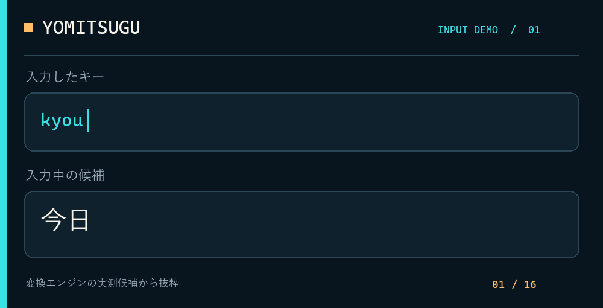
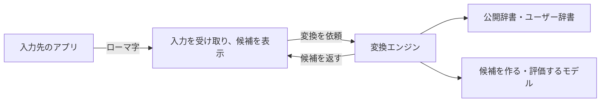

# Yomitsugu（よみつぐ）

Windowsで使える日本語入力ソフト（IME）です。ローマ字を打つと、その場で漢字やかなに変わります。たとえば `GitHubwotsukau` と続けて打つと「GitHubを使う」と表示されます。

**[Windows x64 用インストーラーをダウンロード（Preview 3）](https://github.com/urotsuki-san/Yomitsugu/releases/download/v0.2.10-preview.3/Yomitsugu-0.2.10-preview-x64-setup.exe)** · [リリース情報](https://github.com/urotsuki-san/Yomitsugu/releases/tag/v0.2.10-preview.3)

  
  
  
  
  

## インストールして最初の一語を入力する

1. 上のリンクから `Yomitsugu-0.2.10-preview-x64-setup.exe`をダウンロードして実行します。インストールには管理者権限が必要です。評価版は未署名のため、Windowsが発行元の確認を求める場合があります。
2. メモ帳を開いて入力欄をクリックします。**Windowsキーを押しながらスペースキー**を押し、入力方法の一覧で **Yomitsugu Preview** を選びます。
3. 半角で `insuto-ru` と打ってみてください。入力中に「インストール」と表示されます。そのまま **Enter** で確定します。別の表記を選びたいときは **Space** で候補を開き、**↓** で選んでから **Enter** を押します。

元の日本語入力に戻るときも、Windowsキーとスペースキーで切り替えられます。変換にインターネット接続は不要です。

[使い方・設定・更新](RELEASE.md) · [測定結果](docs/benchmarks/hybrid-14.md) · [ソースからビルドする](docs/development.md)

## 動いているところ

<picture>
  <source media="(prefers-reduced-motion: reduce)" srcset="docs/assets/readme/input-demo-still.png">
  
</picture>

ローマ字を打ち続けると、まだ確定していない部分の表記が変わっていきます。少し手を止めると文全体の候補を見直します。途中でスペースキーを押す必要はありません。

## 何ができるか

| 入力 | 変換例 |
| --- | --- |
| `kyouhaiitennkidesune.` | 今日はいい天気ですね。 |
| `APIwokakuninshitekudasai.` | APIを確認してください。 |
| `samukunaltutekimasitane` | 寒くなってきましたね |
| `ri-domi-` | README |
| `aninsuto-ru` | アンインストール |
| `softwarewokoushinsuru` | softwareを更新する |
| `ri-domi-wokousinnsitekudasaiGithubde` | READMEを更新してくださいGithubで |
| `GitHubwotsukau` | GitHubを使う |
| `yajirushi` | → |
| `ltu` / `a` / `.` | っ / あ / 。 |

よく使う名前はユーザー辞書に登録できます。何度も選び直す表記は、学習を有効にすると同じ読みと文脈で優先されます。設定はスタートメニューの「Yomitsugu」→「設定と辞書」から開けます。入力文と辞書はPC内で扱います。

短い文でも同音語を取り違えることがあります。文節の区切りを手動で伸ばす・縮める操作と、確定した文の再変換は開発中です。Windows x64で、AVX2対応のCPUを使って検証しました。

## Preview 2 から変わったこと

- `geninn` と打つと「原因」が最初に出ます。`teninn` は「店員」、`zeninn` は「全員」に変換します。「下人」など別の表記も候補から選べます。
- ローマ字が英字のまま出るときは、タスクバーの「A」をクリックすると日本語入力に戻ります。英字キーボードでは Shift＋Caps Lock でも切り替えられます。切り替えに使うキーは設定で変更できます。
- 変換中に Tab を押すと次の候補、Shift＋Tab で前の候補を選べます。Enter で確定したあとは、Tab で次の入力欄へ移れます。

[変換の精度・速さ・メモリ使用量](docs/benchmarks/hybrid-14.md)

## 変換の仕組み

入力先のアプリでローマ字を受け取り、別のプロセスで辞書を引いて候補を作ります。「自動最適化」では辞書と変換モデル（Jinen）の候補を比べます。候補が割れたときは、別のモデル（iroha）でも文全体を採点します。

[変換方式の違い](HYBRID.md) · [開発ガイド](docs/development.md) · [従来版の入力経路図（HTMLを保存して開く）](docs/architecture/yomitsugu.html)

## ライセンス

独自コードは [MIT](LICENSE) です。AzooKey、myime、モデル、Mozc・EDRDG・Unicode 由来の辞書データには別の条件があります。出典とライセンスは [THIRD_PARTY.md](THIRD_PARTY.md) に記載しています。Yomitsugu はこれらのプロジェクトの公式製品ではありません。

